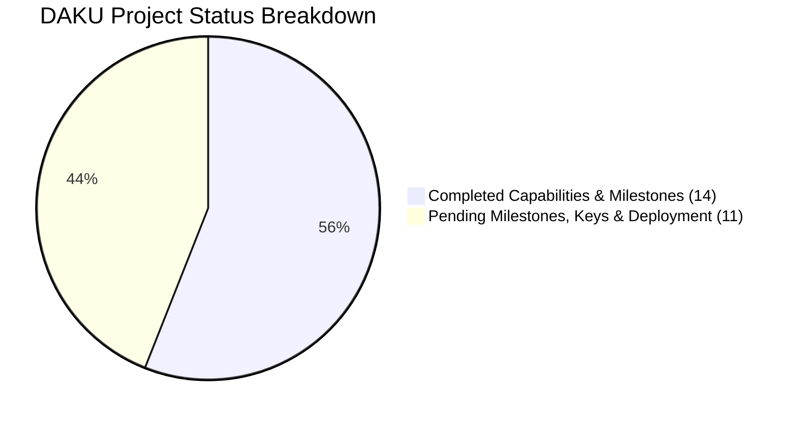

# DAKU — Completed vs. Remaining Tasks & Roadmap
================================================================================

**Project**: DAKU (Personal Voice AI Agent & Autonomous Swarm)  
**Host Architecture**: Windows 10/11 AMD64 (AMD Athlon Silver 3050U, 4 GB RAM)  
**System Profile**: Zero-local LLM, ultra-low memory (<25 MB server working set)  
**Regression Test Status**: **222 / 222 tests passing** (0 failures, 2 skipped)  
**DeepSeek Harness (`dsh`) Status**: **INTEGRATED & VERIFIED** (Cordis Bridge Active)  
**Memory & MCP Gateway Status**: **HARDENED & CERTIFIED** (10-Tier SQLite FTS5 + Declarative ACLs)  
**Date**: November 2026  

---

## 1. Executive Summary

| Category | Total Items | Completed / Ready | Remaining / Pending | Progress |
| :--- | :---: | :---: | :---: | :---: |
| **Core Architecture & Engine** | 8 Phases | 8 Phases | 0 Phases | **100%** |
| **User Interfaces (Voice, Web, CLI)** | 4 Interfaces | 3 Interfaces | 1 Interface (Native Desktop HUD) | **75%** |
| **Planned Architectural Milestones** | 5 Milestones | 2 Completed | 3 Milestones (Phases 9, 10, 11) | **40%** |
| **Environment & Cloud Keys** | 3 Keys | 0 Active | 3 Pending Configuration | **Action Required** |
| **Production Cloud Deployment** | 5 Tasks | 0 Deployed | 5 Pending Tasks | **Action Required** |
| **Overall Project Scope** | **25 Tracked Items** | **14 Completed (56%)** | **11 Pending (44%)** | **56%** |

---

## 2. Completed Capabilities (What is Done)

### [COMPLETED] Phase 1: Voice MVP & Audio Pipeline
- **Push-to-Talk Speech Recognition**: Windows microphone capture via `speech_recognition` with automatic silence detection and offline fallback.
- **Native Windows Speech Synthesis (TTS)**: Built-in Windows SAPI (`Microsoft David` / `Microsoft Zira`) with double-redundant COM error handling.
- **Text Fallback**: Headless and keyboard-driven text input/output when no audio devices are available.

### [COMPLETED] Phase 2: Local Computer Agent & 3-Tier Security
- **Native OS Tool Suite**:
  - `application.py`: Detect installed apps, launch approved software, verify running processes.
  - `browser.py`: Web browsing, searching, title/text extraction, DOM inspection.
  - `file_ops.py`: Safe listing, searching, reading, creating, and metadata checks.
  - `system.py`: Hardware inspection (ctypes-based RAM, CPU load, disk usage, OS info).
- **Security Boundaries**:
  - 3-tier permission model: `SAFE` (automatic execution), `CONFIRMATION_REQUIRED` (user approval needed), and strictly `BLOCKED` (prohibited actions).
  - Absolute ban on raw PowerShell/command-line execution.
  - Automated masking and redaction of credentials in logs and outputs.

### [COMPLETED] Phase 3: Multi-Step Task Automation & State Machine
- **TaskPlanner State Machine**: Deterministic 5-stage lifecycle (`PLANNING` → `AWAITING_CONFIRMATION` → `EXECUTING` → `VERIFYING` → `COMPLETED`).
- **Safety Circuit Breakers**: Hard limits of maximum 10 steps per task and maximum 2 automatic retries per step.
- **Real-World Verification Gate**: Actions must be verified against actual OS state before reporting completion.
- **Tool Routing**: Native tools take priority; falls back gracefully to registered MCP tools.

### [COMPLETED] Phase 4: Remote Cloud Backends & Zero-Local LLM Guard
- **Backend Implementations**:
  - `DirectModelRouter`: Direct cloud LLM connection via OpenAI-compatible endpoints with function calling.
  - `DeepSeekHarnessBackend`: Session state management and tool dispatch conforming to DeepSeek Harness architecture.
  - `UncensoredR1Backend`: Support for DeepSeek R1 Distill / Uncensored endpoints with automated `<think>...</think>` tag stripping for voice output.
- **Local Model Guard**: Zero heavy local model inference (<15 MB working set memory, <1% idle CPU).

### [COMPLETED] Phase 5 & 5.5: Remote Hosting & Hands-Free Voice Confirmation
- **Lightweight Server Daemon**: HTTP/REST daemon (`server/daku_server.py`) built with Python standard library (`http.server`).
- **Security & Auth**: Constant-time Bearer token verification and loopback-safe local development mode.
- **Voice Confirmation Loop**: Hands-free voice authorization parsing `YES`, `NO`, `CANCEL`, and `STOP`.
- **Cloud Infrastructure Config**: Oracle Cloud Always Free deployment scripts, UFW firewall rules, and systemd service descriptors.

### [COMPLETED] Phase 6: Adaptive Multi-Pass Reasoning & Safe Self-Learning
- **`MultiPassReasoner` (`brain/multipass.py`)**: Dynamic complexity budgeting (1 to 8 passes) based on task difficulty.
- **Loop Protection**: Repeated action detection prevents runaway loops.
- **`ReflectionEngine` (`brain/reflection.py`)**: Automatic failure diagnosis and safe strategy pivoting (e.g. Edge when Chrome fails).
- **`LearningEngine` (`brain/learning.py`)**: Compact, bounded lesson store (max 500 lessons) to remember successful strategies without code alteration.

### [COMPLETED] Phase 6.1: Sarvam AI Voice Agent Integration
- **Indian Language Support**: Integrated Sarvam Saaras:v4 STT and Bulbul:v3 TTS.
- **Resilient Fallback**: Automatic failover to Google STT and Windows SAPI if Sarvam API key is missing or network times out.

### [COMPLETED] Phase 7: Solar Swarm HUD v7.0.0 (Dashboard UI)
- **Celestial Visual Engine**: 2D/3D Canvas visualizer with Central Sun (DAKU Brain) and 4 planetary swarm agents (Researcher, Coder, Vision Analyst, Executive Strategist).
- **Real Voice Turn Loop**: Browser Web Audio API microphone capture, audio playback, and 10 UI status states (`STANDBY` to `OFFLINE`).
- **Telemetry & Capability Drawer**: Real-time agent status inspection via `/api/hud/agents`.
- **Safe Profile Management**: Add/switch agent profiles with privilege escalation prevention.

### [COMPLETED] Phase 14: AI Tools & MCP Ecosystem
- **Ponytail (v4.10.0)**: Over-engineering auditor and complexity reviewer.
- **Context7 (v4.5.0)**: Up-to-date documentation resolution MCP server.
- **Playwright MCP (v0.0.82)**: Headless browser automation engine.
- **Graphify (v0.9.64)**: Codebase AST knowledge graph generator.
- **Google ADK (v2.13.0)**: Agent Development Kit installed in `.venv-adk` with 7 official skills and ADK Docs MCP.
- **MCP Discovery**: 32 MCP servers with 270 tools discovered and healthy.

### [COMPLETED] DeepSeek Harness (`dsh`) Integration & Cordis Plugin Bridge
- **`brain/deepseek_harness_bridge.py`**:
  - Exposes DAKU native tools (`application`, `browser`, `filesystem`, `system`) and MCP servers as Cordis plugins.
  - Multi-turn session state with monotonic append-only event logging (`session/created`, `turn/start`, `tool/executing`, etc.).
  - 3-tier security gate dispatch enforcing `SAFE`, `CONFIRMATION_REQUIRED`, and `BLOCKED`.
  - `<think>...</think>` reasoning trace extraction for HUD telemetry with automatic voice stripping for clean speech synthesis.
- **Server HUD Telemetry Sync**: `/api/hud/agents` synced with active DeepSeek Harness pass count, session ID, and plugin mappings.
- **Verification Script**: `scripts/verify_harness_live.py` passed all 7 validation gates.
- **Test Certification**: 14/14 unit tests in `tests/test_deepseek_harness_bridge.py` passed.

### [COMPLETED] Milestone 4: Structured 10-Tier Memory Persistence Engine
- **`brain/memory_store.py`**:
  - Zero-dependency unified persistence on Python's built-in `sqlite3` + `FTS5`.
  - Low-RAM speed & safety pragmas: `PRAGMA journal_mode=WAL; PRAGMA synchronous=NORMAL; PRAGMA temp_store=MEMORY; PRAGMA cache_size=-4000;` (capped at ~4 MB RAM).
  - Complete 10-Tier schema:
    1. `WORKING_BUFFER` (ephemeral turn state)
    2. `SHORT_TERM_SESSION` (active session context & history)
    3. `EPISODIC_EVENTS` (timestamped task & tool outcomes)
    4. `SEMANTIC_FACTS` (SQLite `FTS5` virtual table with BM25 relevance ranking)
    5. `PROCEDURAL_LESSONS` (bridge hook for `LearningEngine` strategies)
    6. `USER_PROFILE` (multi-user preferences, language, voice settings)
    7. `SECURITY_AUDIT_LOG` (immutable log of `CONFIRMATION_REQUIRED` and `BLOCKED` actions)
    8. `AGENT_SWARM_STATE` (Solar HUD agent telemetry snapshots)
    9. `MCP_TOOL_CACHE` (discovered tool schemas & reliability scores)
    10. `ARCHIVAL_SUMMARY` (compacted cross-session checkpoints)
  - Thread-safe, multi-user isolation, TTL expiration pruning, and session context continuity.
  - Certified by 7/7 unit tests in `tests/test_memory_store.py`.

### [COMPLETED] Phase 8: MCP Permission Gateway Hardening
- **`brain/mcp_gateway.py` & `config/mcp_acl.json`**:
  - Declarative per-server and per-tool Access Control Lists (ACLs).
  - Unknown server safety fallback: any server not explicitly registered defaults to `CONFIRMATION_REQUIRED`.
  - Token Isolation Boundary: strips `MODEL_API_KEY`, `SARVAM_API_KEY`, `DAKU_AUTH_TOKEN`, and other secrets from child MCP process environments unless explicitly allowlisted.
  - In-Memory Token-Bucket Rate Limiter: prevents runaway tool loops using `time.monotonic()` with per-server refill rates and burst capacities.
  - DeepSeek Harness Bridge Integration: automatically routes MCP tool dispatches through the gateway, recording violations in session events and `SECURITY_AUDIT_LOG`.
  - Certified by 5/5 unit tests in `tests/test_mcp_gateway.py`.

---

## 3. Pending Tasks (The Exact Pending List)

There are **11 pending items** categorized across three operational groups:

### Group A: Live Credentials & Configuration (3 Pending Tasks)
1. **[PENDING] Set `MODEL_API_KEY` in `.env`**: Required to unlock live cloud LLM reasoning with DeepSeek (`deepseek-chat`) or OpenAI. Currently falling back gracefully to local deterministic intent matching.
2. **[PENDING] Set `SARVAM_API_KEY` in `.env`**: Required to activate Sarvam AI's Saaras:v4 (speech-to-text) and Bulbul:v3 (text-to-speech) for Hindi and Indian regional languages. Currently operating on Google STT and Windows SAPI fallback.
3. **[PENDING] Set `DAKU_AUTH_TOKEN` in `.env`**: Required to enforce constant-time Bearer authentication before exposing the DAKU daemon to remote clients or public internet traffic. Currently running in open local development mode.

### Group B: Planned Architectural Milestones (3 Pending Milestones)
4. **[PENDING] Phase 9: JARVIS Native Desktop HUD UI**: Lightweight native desktop overlay window (Tkinter / PySide / Win32) with system tray and real-time audio visualizer to complement the web-based Solar HUD.
5. **[PENDING] Phase 10: Skill Architecture & Reusable Registry**: Standalone, versioned automation skill modules; standard skill manifest (`SKILL.md`); plug-and-play skill registry.
6. **[PENDING] Phase 11: Money Engine & Opportunity Scanner**: Autonomous web opportunity finder; bounty/freelance scanner; ROI calculation engine and lead discovery.

### Group C: Production Cloud Hosting Deployment (5 Pending Tasks)
7. **[PENDING] Provision Oracle Cloud Compute Instance**: Setup Always Free ARM Ampere / x64 Ubuntu VM.
8. **[PENDING] Firewall Hardening (UFW)**: Allow inbound traffic only on ports 22, 80, 443; block port 8443 from WAN.
9. **[PENDING] SSL/TLS Reverse Proxy**: Configure Nginx reverse proxy with automated Let's Encrypt certificates.
10. **[PENDING] Systemd Daemon Service**: Install and enable `daku.service` for 24/7 background operation.
11. **[PENDING] Public DNS Record**: Bind domain / subdomain to the Oracle Cloud instance public IP.
